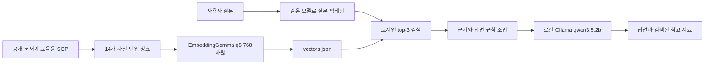

# 상세페이지 제작 준비 안내 RAG

자료를 먼저 찾고, 그 자료를 근거로 상세페이지 제작 준비를 안내하는 **로컬 RAG 과제**입니다. 물류창고 예제를 홈페이지·상세페이지 제작 업무로 변형했습니다.

**웹 화면·서버·배포 없이 터미널에서 실행합니다. 실제 고객 계약서나 비공개 자료는 포함하지 않았습니다.**

> AI 보조로 코드·교육용 SOP·실행·검토를 작성했습니다. 아래 숫자와 답변은 실제 로컬 실행 기록이며, 학생 본인이 직접 실행하거나 독립 평가했다고 주장하지 않습니다. 제출자는 내용을 확인하고 자신의 말로 설명해야 합니다. 교육용 SOP는 실제 회사 정책이 아닙니다.

## 1. 무엇을 답하고 무엇을 답하지 않나요?

- 대상: 상세페이지 제작자와 제작을 의뢰하려는 고객.
- 답할 수 있는 것: 준비자료, 사진 확인 절차, 성능 표현의 증빙, 수정 범위 확인, 모바일·접근성 검수.
- 답할 수 없는 것: 실제 프로젝트 가격·납기·수정 횟수, 실시간 상품 재고, 미제공 사진의 품질, 특정 상품 효능, 날씨, 매출 보장.
- 상세 설계: [docs/design.md](docs/design.md), 변경 시 지킬 계약: [CLAUDE.md](CLAUDE.md).

## 2. 동작 원리



1. 자료를 독립된 사실 단위로 나누고 출처와 ID를 붙입니다.
2. 문서와 질문을 같은 임베딩 모델·입력 규칙으로 숫자 768개로 바꿉니다.
3. 질문과 가장 가까운 청크 3개를 고릅니다. 이 단계에는 생성 LLM이 없습니다.
4. 찾은 자료와 근거 제한 규칙을 Ollama에 보내 답변을 생성합니다.
5. 답변과 검색된 자료를 함께 보고, 무근거 답변과 잘못된 인용을 대조합니다.

## 3. 사용 기술과 재현 환경

- Node.js: 20.19 이상을 기준으로 작성. 실제 검증 버전 **v26.5.0 / Windows x64**.
- 임베딩: transformers.js **4.3.1**, `onnx-community/embeddinggemma-300m-ONNX`, `q8`, mean pooling, normalize=true, 768차원.
- 문서 입력: `title: {section} | text: {text}`
- 질문 입력: `task: search result | query: {question}`
- 생성: 로컬 Ollama `qwen3.5:2b`, temperature=0, seed=42, think=false, 최대 320토큰.
- 검색: 정규화 벡터 내적, top-k=3, 약한 근거 기준 0.55. 높은 점수가 정답을 보장하지 않습니다.
- 실제 모델 digest와 설정·운영체제는 [최신 실험 manifest](experiments/runs/2026-10-13T07-16-25-667Z/manifest.json)에 보존했습니다.
- 첫 실행은 패키지·임베딩 모델 다운로드로 시간이 걸립니다. 관측한 임베딩 캐시 총량은 약 316MiB이며 모델 본체와 토크나이저를 포함합니다. Ollama 모델은 별도로 준비합니다.

## 4. 실행 방법

Node.js와 [Ollama](https://ollama.com/download/windows)를 설치하고 Ollama 앱을 실행합니다. 명령을 찾지 못하면 설치 후 터미널을 다시 열어 PATH를 갱신합니다. 이 프로그램은 로컬 HTTP API에 연결하므로 Ollama 앱이 이미 실행 중이면 사용할 수 있습니다.

```powershell
git clone https://github.com/jongmins0410-cmyk/detailpage-rag.git
cd detailpage-rag
npm ci
ollama pull qwen3.5:2b
node src/build-index.mjs
node src/search.mjs "상세페이지 제작 전에 어떤 상품 정보를 준비해야 하나요?"
node src/ask.mjs "일반 텍스트와 큰 텍스트의 최소 대비 기준은 각각 얼마인가요?"
```

`npm install`도 가능하지만 제출 시점의 정확한 의존성 재현은 `npm ci`를 권장합니다. Ollama 명령이 이미 설치되어 있고 모델도 내려받았다면 pull은 다시 할 필요가 없습니다.

### 옵션과 비교

```powershell
node src/search.mjs "사진이 두 장이면 충분한가요?" --k 5
node src/ask.mjs "무료 수정은 몇 번인가요?" --show-prompt
node src/ask.mjs "일반 텍스트의 최소 대비는?" --no-rag
node src/ask.mjs "일반 텍스트의 최소 대비는?"
node src/ask.mjs "제작 준비물은?" --log .local-logs/demo.json
node src/ask.mjs "제작 준비물은?" --json
npm test
npm run validate
npm run experiment
```

- `--k`: 검색 개수 1~20, 기본 3.
- `--show-prompt`: 실제 모델 입력을 표준 오류 출력으로 보여줍니다.
- `--no-rag`: 자료 없이 같은 LLM에 묻는 비교 모드. 인덱스나 임베딩 모델을 사용하지 않습니다.
- `--log`: 질문과 답변이 들어가므로 Git 제외 폴더 `.local-logs/`에만 저장합니다. 제출 실험은 고정된 교육용 질문만 별도 보존했습니다.
- `--json`: stdout에 구조화된 실행 기록, 안내 로그는 stderr로 분리합니다.
- `OLLAMA_HOST`: 기본 `http://127.0.0.1:11434`, 로컬 주소만 허용합니다.
- `OLLAMA_TIMEOUT_MS`: 기본 300000ms, 허용 1000~900000ms.
- `RAG_CACHE_DIR`: 모델 캐시 위치를 바꿀 때만 지정합니다. 문서·질문이 같은 모델 설정을 사용하는 규칙은 유지합니다.

문서가 바뀌면 `node src/build-index.mjs`를 다시 실행합니다. 설정·본문·벡터 차원이 다르거나 인덱스가 오래됐으면 검색을 중단합니다. 공개 출처를 바꾼 경우 `node src/verify-sources.mjs`로 출처 기록도 갱신합니다.

## 5. 자료와 청크 설계

총 14개: 교육용 자체 SOP 10개, W3C·MDN·Google 공식 참고 4개. 각 본문은 120자 이상이며, 정확한 출처 확인 내역은 [docs/sources.md](docs/sources.md)와 [HTTP 재확인 기록](experiments/source-check.json)에 있습니다.

| ID | 주제 | 출처 |
|---|---|---|
| DP-001 | 브랜드·상품 정보 수집 | [교육용 자체 SOP](docs/sop.md#brand-product-intake) |
| DP-002 | 사진 준비도 확인 범위 | [교육용 자체 SOP](docs/sop.md#photo-readiness) |
| DP-003 | 성능·효능 표현의 근거 | [교육용 자체 SOP](docs/sop.md#claim-evidence) |
| DP-004 | 범위와 서면 변경 관리 | [교육용 자체 SOP](docs/sop.md#scope-change-log) |
| DP-005 | 수정 기준의 사전 확인 | [교육용 자체 SOP](docs/sop.md#revision-boundaries) |
| DP-006 | 단계별 확인 게이트 | [교육용 자체 SOP](docs/sop.md#confirmation-gates) |
| DP-007 | 이미지·폰트·콘텐츠 사용 권한 | [교육용 자체 SOP](docs/sop.md#copyright-usage) |
| DP-008 | 모바일·접근성 검토 | [교육용 자체 SOP](docs/sop.md#mobile-accessibility-review) |
| DP-009 | 납품·개인정보 처리 | [교육용 자체 SOP](docs/sop.md#handoff-privacy) |
| DP-010 | 게시 전 최종 점검 | [교육용 자체 SOP](docs/sop.md#final-prepublish) |
| DP-011 | 외부 참고: 이미지 대체텍스트 | [공식 공개 문서](https://www.w3.org/WAI/tutorials/images/decision-tree/) |
| DP-012 | 외부 참고: 텍스트 대비 | [공식 공개 문서](https://www.w3.org/WAI/WCAG22/Understanding/contrast-minimum.html) |
| DP-013 | 외부 참고: 반응형 이미지 | [공식 공개 문서](https://developer.mozilla.org/en-US/docs/Web/HTML/Guides/Responsive_images) |
| DP-014 | 외부 참고: 제품 구조화 데이터 | [공식 공개 문서](https://developers.google.com/search/docs/appearance/structured-data/product-snippet) |

설계 원칙:
1. 한 청크에는 하나의 중심 사실을 넣고 단독으로 읽을 수 있게 합니다.
2. ID·본문·원문 위치를 함께 보존합니다. 로컬 SOP의 실제 본문과 앵커도 자동 검사합니다.
3. 없는 계약이나 수치를 만들어 넣지 않습니다. 교육용 제안과 실제 공식 참고를 구분합니다.

## 6. 1단계 검색 관찰

다음은 E2 실행에서 실제 관측한 값입니다. Q1~Q6은 기대 ID를 미리 정했고, Q7~Q9는 답이 없는 질문이므로 top-3 적중 평가에서 제외했습니다.

| 질문 | 구분 | 검색 1위 | 점수 | 기대 근거 top-3 | 약한 근거 |
|---|---|---|---:|---|---|
| Q1 상세페이지 제작 전에 어떤 상품 정보를 준비해야 하나요? | 정상 | DP-001 | 0.7691 | 포함 | 아니오 |
| Q2 제품 사진이 두 장 있어요. 사진 품질이 좋은지 지금 판단해 줄 수 있나요? | 경계 | DP-002 | 0.6551 | 포함 | 아니오 |
| Q3 제품 효능과 성능 수치를 상세페이지에 쓰기 전에 무엇을 확인하나요? | 정상 | DP-003 | 0.7176 | 포함 | 아니오 |
| Q4 우리 프로젝트 무료 수정은 정확히 몇 번이고 추가 비용은 얼마인가요? | 경계 | DP-005 | 0.6572 | 포함 | 아니오 |
| Q5 웹 검색으로 찾은 사진과 폰트를 바로 사용해도 되나요? | 정상 | DP-007 | 0.6847 | 포함 | 아니오 |
| Q6 일반 텍스트와 큰 텍스트의 최소 대비 기준은 각각 얼마인가요? | 정상 | DP-012 | 0.7690 | 포함 | 아니오 |
| Q7 지금 내 쇼핑몰에서 판매 중인 텀블러의 실제 재고가 몇 개인가요? | 범위밖 | DP-009 | 0.5399 | 해당 없음 | 예 |
| Q8 내일 서울 날씨는 어떤가요? | 무관 | DP-005 | 0.4210 | 해당 없음 | 예 |
| Q9 김치찌개 만드는 레시피를 알려 주세요. | 무관 | DP-001 | 0.4018 | 해당 없음 | 예 |

**기대 근거가 있는 6문항 모두 top-3에 포함되었습니다(6/6). 이는 이 작은 고정 세트의 검색 결과일 뿐 전체 정확도가 아닙니다.**

### 생각해 볼 것

1. 단어가 완전히 같지 않아도 찾는 이유: 임베딩은 문장을 의미 좌표로 바꾸기 때문입니다. 다만 이 실험으로 모든 동의어·표현에 강하다고 일반화하지 않습니다.
2. 날씨·레시피도 검색 1위가 나오는 이유: 검색은 주어진 문서 중 상대적으로 가까운 것을 반드시 고를 수 있습니다. Q8/Q9의 0.4210/0.4018은 관련성이 낮은 신호입니다.
3. 검색 점수만으로 실시간 재고나 계약 유무를 판정할 수 없는 이유: 관련 단어가 있는 절차 문서와 현재의 실제 값은 다릅니다. 이번 Q7은 0.5399로 경고됐지만 다른 표현에서도 항상 걸러진다는 보장은 없습니다.
4. 상위 결과가 모두 답의 근거는 아닌 이유: Q1에는 실제 준비물 DP-001뿐 아니라 구조화 데이터 DP-014도 검색됐습니다. 답 문장이 어떤 자료에 직접 근거하는지 생성 후에도 확인해야 합니다.

## 7. 2단계: RAG 유무 비교

고정 질문 9개를 같은 순서로 실행했고, 각 실험에서 RAG 없이 9번과 RAG로 9번 실행했습니다. 두 실험 합계 **36개 실제 답변 기록**을 보존했습니다. 오류 응답은 0개였지만 이것은 내용이 모두 정답이라는 뜻이 아닙니다.

| 질문 | RAG 없이: 실제 답변 일부 | RAG E2: 실제 답변 일부 | 관찰 |
|---|---|---|---|
| Q1 | 상세페이지를 만들기 위해 반드시 필요한 핵심 정보는 제품 자체의 기능, 구성, 사용법, 그리고 타겟 고객에게 주는 가치입니다.  <br>이러한 내용을 바탕으로 고객이 구매할 때 궁금해할 수 있는 모든 질문을 미리 답변하고, 신뢰감을 주는 구체적인 사례나 비 … | 상세페이지 제작 전에는 브랜드명, 판매 채널, 제품명·옵션·구성 등 핵심 정보를 입력표로 수집해야 합니다. 또한 게시 직전에는 링크·가격·재고·배송 정보와 맞는지 최종 점검을 해야 하며, 확인되지 않은 항목은 임의로 정상이라고 처리하지 않습니다. 이 내용은 교육용 제안 워크플로이며 실제 회사 정책이 아닙니다. | E1은 원문의 확인 불가를 수정 불가로 바꿔 의미가 틀렸다. E2는 내용이 바로잡혔지만 답변 안의 ID 표시는 빠졌다. |
| Q2 | 현재 제공된 이미지 파일의 해상도나 색감으로 제품 사진의 품질을 직접적으로 판단할 수는 없습니다. 정확한 평가는 전문적인 사진 편집 프로그램이나 전문가가 분석해야 하므로, 더 자세한 정보나 비교 기준이 필요하시면 말씀해 주세요. | 제공된 자료는 사진 품질을 직접적으로 판단할 수 있는 근거가 없습니다. [DP-013]에 따르면, 반응형 이미지 안내는 화면 크기와 해상도 차이로 인한 가독성 문제를 해결하는 방법만 다루고 있으며, 실제 이미지의 선명도나 색감·누락 여부를 판정할 수 없으므로 디자이너가 별도로 확인해야 합니다.<br><br>[DP-002] 또한, C … | 두 실행 모두 사진을 보지 못한다고 안내했다. E2는 CLI 제한을 MDN DP-013에도 연결해 인용 근거를 혼합했다. 정확한 근거는 DP-002다. |
| Q3 | 제품의 구체적인 효능과 성능 수치 (예: 임상 데이터, 시험 결과 등) 는 해당 제품과 대상 사용자의 특성에 따라 달라지므로, 정확한 정보를 제공하기 위해 반드시 공식 홈페이지나 신뢰할 수 있는 전문 기관에서 확인해야 합니다.<br><br>회사별 정책이나 가격  … | 1. 제품 효능과 성능 수치를 상세페이지에 쓰기 전에 브랜드명, 판매 채널, 제품명·옵션·구성 등 핵심 상품 정보를 수집해야 합니다. (DP-001)<br>2. 구매 판단에 영향을 주는 표현은 출처·확인일·적용 조건을 문구와 연결해 보관하고, 제조사 자료나 공식 사양과 같은 확인 가능한 근거가 없으면 사실처럼 단정하지 않습니다 … | E1은 시험성적서 내용을 DP-001에 묶고 내부 규칙을 답으로 나열했다. E2는 효능 증빙을 DP-003에 연결하고 불필요한 규칙 나열을 제거했다. |
| Q4 | 구체적인 수정 횟수나 추가 비용은 각 프로젝트의 계약 조건에 따라 달라지므로 정확한 정보를 확인하기 위해 해당 서비스 제공처의 공식 홈페이지나 고객 지원 채널을 직접 조회하셔야 합니다. | 우리 프로젝트의 무료 수정 횟수와 추가 비용은 교육용 SOP 기준이며, 실제 정책이 아니므로 고정 수치나 조건을 만들 수 없습니다. 수정 가능 횟수 및 추가 비용은 프로젝트마다 별도 서면 합의가 있을 때만 적용됩니다. | 두 RAG 실행 모두 실제 수정 횟수·금액을 지어내지 않았다. E2는 근거 ID가 답변 안에서 누락되었다. |
| Q5 | 네, 웹에서 직접 찾은 사진과 폰트는 사용할 수 있습니다. 다만, 저작권 문제나 디자인 일관성 때문에 반드시 확인해야 할 사항이 있습니다. 먼저 해당 콘텐츠의 사용 권한을 확인하고, 브랜드 가이드라인에 부합하는지 검토해 주세요. 또한, 외부 자료로 주 … | 검색된 사진과 폰트는 출처, 라이선스 또는 사용 범위 확인이 필수이며, 불명확한 자산은 대체안으로 처리해야 합니다. [DP-007]에 따르면 검색만으로 권한이 생기지 않으며, 권리 판단이나 법률 조언이 아닌 운영 제안임을 명시합니다. 또한, W3C 와 MDN 의 가이드라인을 참고하여 이미지와 반응형 이미지를 적절히 배치하 … | E1/E2는 검색 발견과 사용 권한을 구분했다. baseline 첫 문장의 사용할 수 있다는 표현은 뒤 조건과 함께 읽어야 하므로 오해 위험이 있다. |
| Q6 | 일반 텍스트와 큰 텍스트의 최소 대비 비율은 1:2000 이라고 합니다. 이는 일반적인 인쇄물이나 디지털 콘텐츠 제작에서 권장되는 표준 수치입니다. 구체적인 적용 시에는 제품 종류, 대상 독자층, 디자인 스타일 등 다양한 요소를 고려하여 조정해야 합니 … | 일반 텍스트 대비 최소 기준은 WCAG 2.2 규정에 따라 4.5:1이며, 큰 텍스트는 3:1로 예외를 적용합니다. [DP-012] 참고하시길 바랍니다. | baseline의 1:2000은 근거 없는 오답이다. 두 RAG 실행은 DP-012의 일반 4.5:1, 큰 텍스트 3:1을 맞게 옮겼다. |
| Q7 | 현재 정확한 재고 수는 실시간으로 업데이트되지 않은 데이터베이스에 저장되어 있지 않습니다.<br><br>구체적인 재고 수치는 해당 쇼핑몰의 공식 홈페이지나 앱에서 확인해야 합니다. 또한, 각 브랜드별 재고 정책이나 배송 기간은 제품마다 다르므로, 구매 전 반드시 … | 검색 결과에 텀블러의 실제 재고 정보가 포함되어 있지 않습니다. 해당 사실은 [DP-010]을 통해 게시 전 최종 점검 단계에서 확인해야 하며, 현재 자료에는 구체적인 숫자가 없습니다. | 실시간 재고 숫자는 두 모드 모두 만들지 않았다. RAG의 자료 한계 안내는 적절하다. 검색 점수 0.5399만으로 다른 질문의 안전도까지 보장할 수는 없다. |
| Q8 | 서울의 날씨를 정확히 알기 위해서는 실시간 기상청 데이터나 최신 예보 사이트를 확인해야 합니다. 정확한 정보를 원하시면 직접 검색해 보시는 것을 추천드립니다. | 서울 날씨는 현재 자료에 포함되어 있지 않습니다. [DP-005] 교육용 SOP 는 고정 수치나 조건을 만들어 내지 않으며, 승인본의 버전명과 승인 시점을 남겨 혼선을 줄인다. 따라서 실제 날씨 정보를 확인할 수 없습니다. | 날씨는 답할 수 없다고 했지만 두 RAG 실행 모두 무관한 수정 SOP DP-005를 덧붙였다. E2에서도 해결되지 않은 실패로 남긴다. |
| Q9 | 요즘 인기 있는 김치찌개 레시피는 크게 두 가지가 있습니다. 첫 번째는 고기나 채소를 넣지 않고 기본 재료만 사용하여 국물이 깔끔하게 끓어오르는 '기본형'입니다. 두 번째는 부침이나 소시지를 함께 넣어 풍미를 더한 '풍부형'으로, 특히 집밥처럼 느끼하 … | 검색 결과에 김치찌개 레시피 관련 정보가 없으므로 해당 내용을 확인할 수 없습니다. | baseline은 범위 밖 레시피를 생성했다. E1은 거절하면서 무관한 DP-014를 붙였다. E2는 무관한 인용 없이 자료 밖이라고 답했다. |

- [E1 답변·검색·프롬프트 원문](experiments/runs/2026-10-13T07-12-33-415Z/manifest.json)
- [E2 답변·검색·프롬프트 원문](experiments/runs/2026-10-13T07-16-25-667Z/manifest.json)
- [AI 보조 검토의 기준과 문항별 판정](experiments/review.json)

비교 범위의 한계: baseline과 RAG는 검색 자료뿐 아니라 근거 제한 규칙도 다릅니다. 따라서 이 결과는 두 파이프라인의 비교이며, 검색만의 순수 인과 효과나 일반적인 성능 수치로 해석하지 않습니다. 따뜻한 모델 캐시와 최초 로딩 차이도 있어 시간 절감률을 주장하지 않습니다.

## 8. 프롬프트 한 변수 수정: E1 → E2

바꾼 변수는 `src/prompt.mjs`의 RAG 시스템 문구 하나입니다. 질문 원문·순서, 코퍼스, top-k, 모델, 생성 설정, baseline 메시지는 그대로 유지했습니다. 별도로 로그 경로·URL·시간 제한 검증을 보강했으나 실험 질문의 모델 입력에는 영향을 주지 않습니다.

- E1 문제: Q1의 의미 왜곡, Q3의 출처 혼합과 규칙 나열, Q8/Q9의 무관한 인용.
- E2 결과: Q1 의미 왜곡과 Q3의 주된 인용 오류·규칙 나열, Q9 무관 인용은 완화되었습니다.
- 회귀/잔여 문제: Q1·Q4의 답변 내 ID가 빠졌고, Q2 출처 혼합과 Q8의 무관한 수정 SOP 인용은 남았습니다.
- 형식상 ID 포함 답변은 E1 9/9에서 E2 6/9로 줄었습니다. 낮은 인용 수가 무조건 나쁜 것도, 많은 인용이 무조건 좋은 것도 아닙니다. 문장과 근거의 관계를 같이 봅니다.
- 결정: E2를 채택하되 남은 실패를 README에 공개했습니다. 고객에게 자동 확정 답변하는 완성 서비스로 취급하지 않습니다.

## 9. 검증과 보안

- 단위 테스트 11개: CLI, 입력 규칙, 청크, 인덱스 설정·해시, 검색, 프롬프트, 로컬 호스트, NDJSON, 출처, 로그 경로, 시간 제한.
- 14개 ID와 768차원 벡터·정규화·원문을 검증했습니다.
- 공식 공개 출처 4개를 실제 요청해 HTTP 200과 제목·본문 해시를 기록했습니다.
- GitHub에는 모델 캐시·node_modules·개인 실행 로그·인증정보를 올리지 않습니다.
- 문서와 질문은 로컬 Ollama로 전송합니다. 인터넷을 사용하는 단계는 최초 설치/모델 다운로드와 명시적 공개 출처 점검입니다.

## 10. 한계와 다음 단계

- 2B 모델은 인용이 있더라도 내용을 잘못 옮기거나 무관한 출처를 붙일 수 있습니다. 자동 ID 검사만으로 환각을 판정할 수 없습니다.
- 14개 자료와 고정 질문 9개만으로 일반적인 정확도나 실제 업무 효율을 보장할 수 없습니다.
- 한국어 SOP는 실제 회사 정책이 아니라 AI 보조로 작성한 교육용 제안입니다. 업무 적용 전 사람의 승인과 실제 계약을 반영해야 합니다.
- 실제 사진 분석·실시간 재고·견적 확정은 구현하지 않았습니다.
- 다음 실험 후보는 더 강한 모델 비교, 인용과 문장의 정합성 검사, 다양한 표현을 포함한 별도 평가 세트입니다. 한 번에 하나씩 바꾸고 기존 질문으로 회귀를 확인합니다.

## 제출 체크리스트

- [x] README: 소개·원리·실행 방법·검색 관찰·RAG 비교·한계
- [x] docs/sop.md와 출처가 확인된 14개 청크
- [x] build-index → search → ask의 실제 로컬 실행
- [x] 실패를 삭제하지 않은 원문 기록
- [x] AI 보조 작성·실행·검토임을 명시

노션 수업 공지의 제출 항목에는 **이 GitHub 저장소 링크**를 기입합니다. 첨부 강의 MD 자체를 제출하는 과제가 아닙니다.
